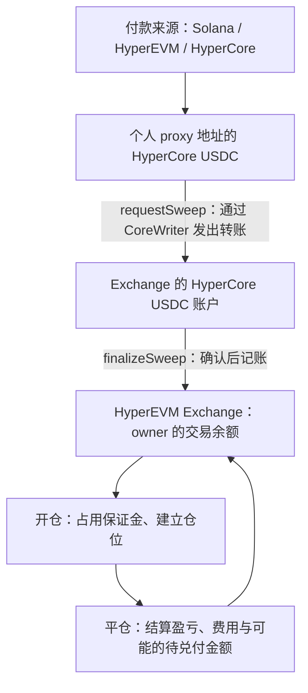
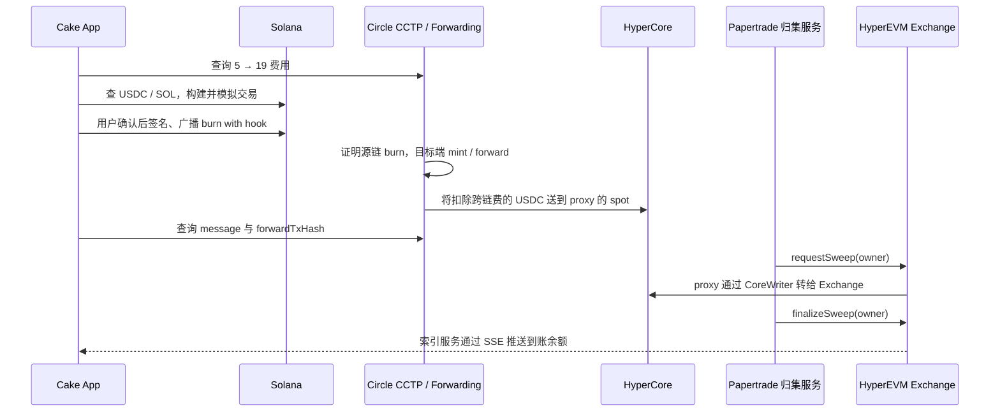

# Cake Wallet × Papertrade 技术说明

更新日期：2026-10-17。范围：本项目现有的充值、BTC 开平仓、账户同步、历史交易实现。

本文区分两类证据：**客户端实现**以仓库代码为准；**合约与服务端流程**以 Papertrade、Hyperliquid、Circle 官方说明为准。仓库不包含 Papertrade 服务端和合约的完整实现，因此不把文中的账本示意当作真实 Solidity 存储布局，也不把公开接口当作有兼容性承诺的正式 SDK。

## 1. 先回答：钱到底在哪里？

Papertrade 需要同时理解三个层次：

| 层次 | 保存什么 | 如何查看 |
| --- | --- | --- |
| HyperEVM 钱包的 ERC-20 余额 | 充值前，付款钱包持有的 HyperEVM 原生 USDC | USDC 合约 `balanceOf(owner)` |
| HyperCore USDC 余额 | 充值先进入个人 proxy 的 Core 账户；归集后进入 Exchange 的 Core 账户 | HyperCore 账本、读预编译及相关查询接口 |
| HyperEVM 上的 Papertrade 交易账本 | 每个 owner 的可用资金、仓位保证金、待兑付金额、仓位和结算状态 | Exchange 合约状态；App 通过 Papertrade 的索引/SSE 服务读取 |

**充值完成后，个人 proxy 通常不再保留刚充值的全部 USDC；它已被归集到 Exchange 的 HyperCore 账户。用户在 HyperEVM 的 Exchange 合约中拥有对应的交易余额记录。**

所以：同一个地址的 HyperEVM ERC-20 余额、HyperCore spot 余额、Papertrade 内部交易余额，是三个不同的数。不能用一个 `balanceOf` 查询代替所有余额。

Papertrade 的仓位、定价和盈亏结算由其 HyperEVM 合约执行。这里的开仓不等于以用户身份在 Hyperliquid 原生永续订单簿上提交一笔订单；HyperCore 在此承担 USDC 账本和报价来源等基础能力。[官方架构说明](https://docs.papertrade.xyz/#/how/architecture)



## 2. 四种地址与密钥

| 名称 | 本项目中的作用 | 是否持有可直接签名的私钥 |
| --- | --- | --- |
| owner / user | 本地选定的 EVM 钱包地址；Papertrade 账户身份 | 软件钱包持有主私钥 |
| deposit proxy | 工厂为 owner 确定的个人充值入口，也对应一个 HyperCore 地址 | 它是合约地址，不存在由 App 持有的“proxy 私钥” |
| Session Key 地址 | 临时交易密钥的公钥地址，授权后代签开平仓消息 | App 本地生成并保存临时私钥 |
| Solana 付款地址 | 提供 Solana USDC 和 SOL 手续费 | 对应 Solana 钱包签名能力，与 EVM owner 分开 |

切换 Cake 当前钱包到 Solana，不会自动把 Papertrade 账户改成 Solana 地址。App 保留选定的 EVM owner，Solana 钱包只是付款来源。多个 EVM 账户存在时，需要确定充值对应的收款 owner。

## 3. CREATE2 的作用与地址计算

### 3.1 为什么要有个人充值地址

每个 owner 对应确定的 proxy 地址，解决了两个问题：

1. **归属识别**：服务看到某个 proxy 收到 USDC，就能关联到对应的 owner。
2. **跨来源统一**：HyperCore 转账、HyperEVM 入金桥、Solana CCTP 都能把资金送到同一个 Core 收款身份。

CREATE2 让地址在合约部署之前就能确定。可以先有充值地址，再由 relayer 按流程部署合约。部署出来的 proxy 负责受限的归集操作；它不是一个 App 随时用私钥控制的普通钱包。

个人地址的好处不代表所有路线都只需一次转账：**当前 HyperEVM 引导充值仍可能需要 USDC approve 和 depositFor 两笔交易**；Solana 也需要一笔源链 CCTP 交易。[官方充值机制](https://docs.papertrade.xyz/#/how/deposits)

### 3.2 通用公式

```text
proxy = last20bytes(
  keccak256(0xff || deployer || salt || keccak256(init_code))
)
```

其中 deployer 是执行 CREATE2 的地址，salt 为 32 字节，init_code 是创建代码及其初始化参数所需的完整字节序列。这里必须使用 Ethereum Keccak-256，不能换成标准 SHA3-256。[EIP-1014](https://eips.ethereum.org/EIPS/eip-1014)

**仅知道 owner 和 factory，不能随意猜 salt 或 init_code。** 本项目没有硬编码一套未经核验的离线派生规则，而是调用部署工厂的只读函数：

```solidity
computeProxyAddress(address user) view returns (address)
```

再把返回值与 `POST /funding/deposits/check` 返回的 `proxy` 比较。两边一致且不是零地址后，才展示可用充值地址。这是只读链上计算加服务端关联校验；不需要部署，也不需要签名。

### 3.3 本地计算示例：调用真实工厂

下面只有公开地址，不包含私钥。2026-10-17 对该工厂的只读查询返回了下列结果：

```text
owner   = 0xe9dc4c1dce3eb696c398eb9228e67f77ea75581c
factory = 0x1629b7d46bef6e13ff754174fc9f32dea309b38f
proxy   = 0x0057e0fe3b1e1edafe9c150c4cc932d073987936
```

无需安装依赖的查询：

```bash
curl https://rpc.hyperliquid.xyz/evm \
  -H 'Content-Type: application/json' \
  --data '{
    "jsonrpc":"2.0",
    "id":1,
    "method":"eth_call",
    "params":[{
      "to":"0x1629b7d46bef6e13ff754174fc9f32dea309b38f",
      "data":"0xd600539a000000000000000000000000e9dc4c1dce3eb696c398eb9228e67f77ea75581c"
    },"latest"]
  }'
```

`0xd600539a` 是函数选择器，后面是补齐为 32 字节的 owner。返回的 ABI word 最后 20 字节就是 proxy：

```json
{"jsonrpc":"2.0","id":1,"result":"0x0000000000000000000000000057e0fe3b1e1edafe9c150c4cc932d073987936"}
```

这是本地发出 RPC 查询，不是脱离 RPC 的纯离线推导。若以后需要纯离线版本，应先核验该部署工厂真实的 salt、初始化代码和实现版本，再与上述返回值做交叉测试。

## 4. 三条充值路径

### 4.1 共用准备步骤

1. 确定 Papertrade EVM owner，保持它与付款钱包的概念分离。
2. 调用工厂计算 proxy。
3. 调用 `/funding/deposits/check` 关联/检查地址，并核对返回的 proxy。
4. 查询付款链余额、交易费和当前待处理充值。
5. 展示来源、收款账户、转出金额、费用、预计到账；用户确认后才签名。
6. 保存已签交易或交易哈希，再广播，避免网络超时导致重复付款。
7. 跟踪源链、目标链和 Papertrade 记账，最终以账户到账状态确认完成。

### 4.2 Solana USDC → Papertrade

本项目直接集成 Circle CCTP V2。没有先调用 Cake Swap 换币，也没有让第三方返回一笔不透明的任意交易供钱包签名。



关键参数：

| 参数 | 当前值 / 含义 |
| --- | --- |
| source domain | `5`，Solana；这是 Circle domain，不是 EVM chainId |
| destination domain | `19`，HyperEVM |
| source mint | `EPjFWdd5AufqSSqeM2qN1xzybapC8G4wEGGkZwyTDt1v`，Solana 原生 USDC |
| instruction | Solana CCTP V2 `deposit_for_burn_with_hook` |
| mintRecipient / destinationCaller | 都设为目标端 CctpForwarder |
| CctpForwarder | `0xb21d281dedb17ae5b501f6aa8256fe38c4e45757` |
| minFinalityThreshold | `1000`，当前客户端选择 Fast 路线 |
| hook 收款地址 | 校验后的个人 proxy |
| hook destinationDex | `4294967295`，HyperCore spot |

这里 destination domain 是 HyperEVM，是因为 CCTP 在该侧完成铸币和转发；**hook 再把资金转到 HyperCore spot**。最后还需要 Papertrade sweep 入交易账本。因此不能把“CCTP 转发完成”等同于“Papertrade 可用余额已经更新”。[Circle 官方路线](https://developers.circle.com/cctp/howtos/transfer-usdc-from-solana-to-hypercore)

费用分开看：

- Solana 交易费与 CCTP 事件账户租金，用 SOL 支付。已有少量 SOL 仍可能不够覆盖两者。
- CCTP 协议费与目标端 forwarding 费用，以 USDC 计；每次读取实时费用。
- Papertrade 首次充值还有 1 USDC 激活费用；当前客户端要求首笔跨链扣费后至少到达 11 USDC，后续至少 10 USDC。
- 客户端给高档 forwarding 估算增加 10% 缓冲，计算并展示满足净到账要求的最低转出额；确认前重新报价。

费用不写死为固定 USDC 值。源链金额使用 6 位小数，费用按整数向上取整。确认前验证主网 genesis、USDC mint、token account 归属、USDC/SOL 余额和模拟结果。

### 4.3 HyperEVM USDC → Papertrade

1. 查 owner 的 HyperEVM 原生 USDC 和 HYPE。
2. 查 `allowance(owner, CoreDepositWallet)`。
3. 授权不足时，签名 `USDC.approve(bridge, amount)`；仅授权本次金额。
4. 签名 `CoreDepositWallet.depositFor(proxy, amount, 4294967295)`。
5. USDC 进入 proxy 的 HyperCore spot。
6. Papertrade sweep / finalize 后，更新 owner 的交易余额。

这条路线需要 owner 的 HyperEVM 交易签名和 HYPE gas，**不使用交易 Session Key 付款**。

直接向 proxy 发一笔普通 HyperEVM ERC-20 转账，不属于当前监控的充值路径，不能期待自动计入交易余额。官方说明误入该侧的 ERC-20 有独立恢复函数 `withdrawStuckToken`，本 App 尚未提供该恢复入口。

### 4.4 HyperCore spot USDC → Papertrade

1. 用 `/info` 查询 owner 的 spot 余额和账户模式。
2. 标准账户签 `spotSend`；统一账户或 portfolio margin 账户签 `sendAsset`。
3. 转账目标都是 proxy 的 HyperCore spot 地址。
4. 通过 Hyperliquid `/exchange` 提交主钱包签名动作。
5. 等待 Papertrade sweep / finalize。

当前 App 支持以 **spot USDC** 作为该路线来源，没有实现自动从用户 perp 余额搬到 spot 再充值的额外流程。

## 5. Sweep 与 HyperEVM 记账

### 5.1 为什么分 request 和 finalize

HyperEVM 合约通过读预编译观察 HyperCore；通过 CoreWriter 系统合约向 HyperCore 发动作。发出动作和确认 Core 账本变化是不同阶段，因此需要分开处理。[Hyperliquid 跨环境接口](https://hyperliquid.gitbook.io/hyperliquid-docs/for-developers/hyperevm/interacting-with-hypercore)

按 Papertrade 官方说明：

1. 归集服务发现 proxy 达到最低金额；首次还需部署 proxy。
2. `requestSweep(user)` 记录 proxy 的 Core 余额快照，并让 proxy 发出归集转账。
3. proxy 的 `sweepAllToExchange` 只能由 Exchange 调用，内部通过 CoreWriter 转到 Exchange 的 Core 账户。
4. Core 转账执行后，`finalizeSweep(user)` 根据余额变化校验并计入 owner 的内部余额。

正常归集门槛为 10 USDC，官方说明会考虑 proxy 的 spot 和可提 perp 余额；本 App 的引导充值目标是 spot。金额太小会在入口等待累计。

若 proxy 余额未按预期下降，finalize 不能直接按旧快照记账；例如转账失败，或同一窗口又来一笔充值遮蔽了下降。官方有重新归集以及 owner 执行 `reconcileSweepCredit` 的异常处理机制。因此客户端一次只推进一笔充值，避免并发入金增加对账复杂度。[官方 sweep 说明](https://docs.papertrade.xyz/#/how/deposits)

### 5.2 “余额记录”是什么

可以用下列逻辑模型理解；它不是部署合约的准确变量名：

```text
owner → { 可用交易余额, 已锁定保证金, 待兑付金额, 仓位集合, 授权的 session keys }
```

HyperEVM 节点维护这些智能合约状态。App 不是自己往数据库加钱；Papertrade 索引服务将链上状态整理成适合展示的账户快照和增量事件。

客户端实际消费的字段包括：

| 字段 | 客户端用途 |
| --- | --- |
| `funds.availableBalance` | 可用于新开仓的余额 |
| `locked` | 已占用保证金 |
| `queued` | 待兑付金额；不按可用现金处理 |
| `openPositions` | 当前持仓 |
| `operations` / `intentOutcomes` | 排队动作与请求结果 |
| `sessionKeys` | 已登记的交易授权地址与过期时间 |
| `lifetime.depositedRaw` 等 | 累计入金、已实现盈亏等统计 |
| `accountRevision` / `baseAccountRevision` | 快照/补丁版本一致性校验 |

开仓时占用账户保证金并建立仓位；平仓时释放保证金、结算盈亏和费用。盈利不保证全部立即变成可用余额，需遵守协议的 LP 偿付和 payout queue 规则。**不能把 available、locked、queued 简单相加后称为“可立即提现余额”。**

展示单位：充值转账用 USDC 6 位，Papertrade 余额/保证金/盈亏用 18 位；使用 BigInt 运算，禁止用 double 生成签名金额。接口快照是查询视图，不是另一个独立的资金保管层。

## 6. Session Key：为什么没有每次弹主钱包签名

### 6.1 两级授权

```text
主钱包私钥
  └─ 签 RegisterSessionKey：允许 key 为 user 开平仓，直到 expiry
       └─ Session 私钥：为每个 OpenPosition / Close 分别签名
            └─ Relayer → BatchExecutor → Exchange 校验并执行
```

**每次下单都有签名，只是后续由本地 Session 私钥签，通常不再触发主钱包授权弹窗。**

本 App 在用户确认交易后，若不存在有效 Session：

1. 用 `Random.secure()` 生成 secp256k1 临时密钥。
2. 保存到系统安全存储，按 chainId、Exchange、owner 隔离。
3. 由 EVM owner 签 EIP-712 `RegisterSessionKey`。
4. 发送 `/intents`，等待账户事件确认 key 已登记。
5. 登记成功后才允许用该 key 签本次交易。

仅本地生成 key 或收到 HTTP 200 都不算授权完成。`sessionActive` 同时检查本机 key、过期时间，以及账户 `sessionKeys` 中是否存在有效登记。

### 6.2 有效期与权限边界

| 项目 | 当前 App | 官网说明 |
| --- | --- | --- |
| Session 有效期 | 24 小时 | 当前官方页面为 30 天 |
| 临近过期处理 | 保留 60 秒余量 | 官网按其自身策略更新 |
| 单条 intent deadline | 签名时刻后 1 小时 | 官方同样说明单条交易有时效 |
| 开仓资金来源 | 当前提交 `useDebt=false`，使用可用余额 | 协议也存在 queued balance 相关能力 |

Session 只授权协议允许的交易操作，不是把主私钥交给 Papertrade，也不是对 USDC 的无限 ERC-20 allowance。官方说明其不能提现或执行 PAPER 质押/领取；这些需要主钱包授权。密钥泄露仍可能导致被恶意开平仓、损失交易余额。官方提供主钱包调用 `SessionKeyManager.revokeSessionKey` 的撤销能力，当前 App **尚未提供专门撤销入口**。[Session 官方说明](https://docs.papertrade.xyz/#/learn/session-keys)

### 6.3 它如何“操作 CREATE2 地址的钱”

充值完成后，交易使用的是 `Exchange` 为 owner 记录的余额。Session 的权限是“代 owner 提交 Exchange 开平仓指令”。它没有获得 proxy 私钥，也没有通过签名任意调用 proxy 转币。

proxy 的资金转移走 Exchange → proxy → CoreWriter 的受限归集路径；开仓走签名 → relayer → Exchange 的交易账本路径。这两个流程关联同一个 owner，但授权和用途不同。

## 7. 下单与平仓消息

### 7.1 EIP-712 Domain

当前代码及已有签名回归样本使用：

```json
{
  "name": "String",
  "version": "1",
  "chainId": 999,
  "verifyingContract": "0x6cd5661646289fb6e65ea5c032310fded797d0a2"
}
```

`name` 确实是字面值 `String`，不能根据产品名称改成 Papertrade。Domain 和结构体共同参与摘要；链、合约或字段类型变化都会改变签名。[EIP-712](https://eips.ethereum.org/EIPS/eip-712)

| 类型 / action | 签名者 | 消息字段 |
| --- | --- | --- |
| `RegisterSessionKey` / `registerSessionKey` | 主钱包 | `user,address; key,address; expiry,uint64; feeAddress,address; nonce,uint256; deadline,uint64` |
| `OpenPosition` / `openPosition` | 有效 Session | `user,address; instrumentId,uint32; isLong,bool; size,uint128; leverage,uint32; useDebt,bool; nonce,uint256; deadline,uint64` |
| `Close` / `closePositions` | 有效 Session | `user,address; positionIds,uint256[]; nonce,uint256; deadline,uint64` |

这里 `size` 是本客户端提交的保证金金额，18 位定点数，不是 BTC 数量。举例：10 USDC 保证金、100×，`size="10000000000000000000"`，`leverage="100"`，对应名义敞口约 1000 USDC。

### 7.2 提交示意

```json
{
  "action": "openPosition",
  "signed": {
    "user": "<EVM owner>",
    "instrumentId": "0",
    "isLong": true,
    "size": "10000000000000000000",
    "leverage": "100",
    "useDebt": false,
    "nonce": "<本机生成并持久化的 nonce>",
    "deadline": "<Unix 秒>",
    "r": "<签名 r>",
    "s": "<签名 s>",
    "v": "27 或 28"
  }
}
```

这是消息结构示例，不是可直接广播的有效订单。当前 nonce 从本地安全随机初值开始，持久化后递增；它不是 EVM 交易 nonce。EIP-712 标准本身不提供重放保护，nonce/deadline 的校验需要协议配合。

客户端先恢复签名地址校验，再计算 intentId、持久化签名请求，最后 `POST /intents`。当前 intent ID 构造为：

```text
keccak256(utf8("papertrade:intent-id:v2") || EIP712_digest || signer_address_bytes20)
```

HTTP 回执中的 action/intentId 需与本地一致；回执表示受理阶段，不直接证明仓位已成交。

### 7.3 谁付 gas，谁执行订单

App 产生链下签名；Papertrade relayer 将请求送至授权的 BatchExecutor，由后者调用 Exchange。链上验证授权与消息后，读取 BBO 并执行交易，更新余额/仓位。该批次交易由 relayer 发出，用户无需为每个 intent 单独发送 HYPE 交易。

当前协议交易入口受 relayer/batch 权限控制，不能因为能生成签名，就假设任意第三方地址能绕过 relayer 直接向 Exchange 开仓。充值源链交易仍由付款钱包负责其费用。

开仓前客户端刷新规则，验证最小保证金、名义金额、杠杆、仓位数量及余额；确认后再次检查账户新鲜度。默认 100×，UI 支持 10–1000× 整数，最终仍以实时协议限制为准。

平仓签名包含具体 `positionIds`。客户端防止同一仓位重复提交；不确定结果重试使用原 nonce、原签名、原 intentId，不自动生成第二笔订单。

## 8. 当前使用的接口清单

### 8.1 Papertrade HTTP / SSE

Base：`https://exchange.papertrade.xyz`。这些是当前生产服务可观察、已被客户端使用的路由；未发现正式稳定版本契约，需为服务变更保留适配能力。

| 方法 | 路径 | 用途 | 签名/副作用 |
| --- | --- | --- | --- |
| GET，长连接 | `/state/user/live?wallet={owner}` | SSE 账户快照、余额、仓位、授权和 intent 结果 | 查询，无交易签名 |
| GET | `/state/trading` | 开平仓开关、市场及交易约束 | 查询 |
| POST | `/funding/deposits/check` | body `{"user":"<owner>"}`；关联/检查 proxy 并推动充值检查 | 不是付款交易，但可能触发后台检查 |
| POST | `/intents` | `{action,signed}`；登记 Session、开仓、平仓 | 携带主钱包或 Session 签名 |
| GET | `/query/accounts/{owner}/trades?filter=all&limit=75` | 已平仓/清算历史 | 查询；后续页附 `cursor` |
| GET | `/query/markets/0/price-history?fromMs=…&intervalMs=…&toMs=…` | BTC 历史价格点 | 查询；按时间瓦片取数 |

账户 SSE 是 **HTTP Event Stream，不是 WebSocket**。客户端处理 `wallet` 和 `liveness` 事件；增量事件必须匹配 base revision，不匹配或心跳超时则重连取快照。离线时不允许把旧余额当作当前可下单额度。

### 8.2 Hyperliquid

| 入口 | 参数/动作 | 用途 |
| --- | --- | --- |
| POST `https://api.hyperliquid.xyz/info` | `{"type":"spotClearinghouseState","user":"<owner>"}` | HyperCore 付款账户 spot 余额 |
| 同上 | `{"type":"userAbstraction","user":"<owner>"}` | 判断标准/统一/portfolio margin 账户 |
| POST `https://api.hyperliquid.xyz/exchange` | 主钱包签名 `spotSend` / `sendAsset` | HyperCore spot 充值到 proxy |
| WS `wss://api.hyperliquid.xyz/ws` | `{"method":"subscribe","subscription":{"type":"bbo","coin":"BTC"}}` | 实时 BTC 最优买卖价；客户端取中间价 |

**当前实现没有连接 `wss://stream.papertrade.xyz/connection/websocket`。** 行情使用 Hyperliquid BBO WS，历史价格使用 Papertrade HTTP，账户使用 Papertrade SSE。界面报价不是保证成交价，执行时仍以合约读取的报价和结算规则为准。

### 8.3 HyperEVM RPC

主 RPC：`https://rpc.hyperliquid.xyz/evm`；备用：`https://rpc.hypurrscan.io`。

| JSON-RPC 方法 | 用途 |
| --- | --- |
| `eth_call` | 工厂算 proxy；USDC `balanceOf`、`allowance` |
| `eth_chainId` | 验证当前链为 999 |
| `eth_getBalance` | 付款地址 HYPE 余额 |
| `eth_getTransactionCount` | 原生交易 nonce |
| `eth_estimateGas` / `eth_gasPrice` | 估算 HyperEVM 充值交易费用 |
| `eth_sendRawTransaction` | 广播本地签好的 approve / depositFor |
| `eth_getTransactionReceipt` | 检查 HyperEVM 充值与 Circle forwarding 回执 |

### 8.4 Circle 与 Solana

Circle Base：`https://iris-api.circle.com`。

| 方法 | 路径 | 用途 |
| --- | --- | --- |
| GET | `/v2/burn/USDC/fees/5/19?forward=true&hyperCoreDeposit=true` | 当前 Fast 协议费及 forwarding 费 |
| GET | `/v2/messages/5?transactionHash={solanaSignature}` | CCTP message、forwardState、delayReason、forwardTxHash |

Solana RPC 使用所选付款钱包配置的 `rpcUrl`，不固定为唯一供应商：

| 方法 | 用途 |
| --- | --- |
| `getGenesisHash` | 主网核对 |
| `getBalance` / `getTokenAccountsByOwner` | SOL 和原生 USDC 余额、token account 归属 |
| `getMinimumBalanceForRentExemption` | CCTP 事件账户租金 |
| `getLatestBlockhash` / `getFeeForMessage` | 构造交易、有效高度与手续费估算 |
| `simulateTransaction` | 签名前预检 |
| `sendTransaction` | 广播已签交易；异常恢复时仅重播相同字节 |
| `getSignatureStatuses` / `getBlockHeight` | 确认源链状态、判断是否已过期 |

## 9. 合约与程序常量

以下是本版本代码常量，不代表未来永远不变；升级时需核对部署和签名域。

| 名称 | 地址 |
| --- | --- |
| Papertrade Exchange，chainId 999 | `0x6cd5661646289fb6e65ea5c032310fded797d0a2` |
| DepositProxyFactory | `0x1629b7d46bef6e13ff754174fc9f32dea309b38f` |
| CoreDepositWallet | `0x6b9e773128f453f5c2c60935ee2de2cbc5390a24` |
| HyperEVM 原生 USDC | `0xb88339cb7199b77e23db6e890353e22632ba630f` |
| CctpForwarder | `0xb21d281dedb17ae5b501f6aa8256fe38c4e45757` |
| Solana CCTP V2 TokenMessenger | `CCTPV2vPZJS2u2BBsUoscuikbYjnpFmbFsvVuJdgUMQe` |
| Solana CCTP V2 MessageTransmitter | `CCTPV2Sm4AdWt5296sk4P66VBZ7bEhcARwFaaS9YPbeC` |

没有在 App 中硬编码调用 BatchExecutor、SessionKeyManager 的地址来直接交易；这些由协议转发路径处理。将来增加主动撤销功能时，应核验实际 SessionKeyManager 部署，不能把 Exchange 地址当作它。

## 10. 历史交易与对账

历史列表按 **owner** 查询，不按 Solana 付款地址或 proxy 查询。服务返回 `items` 和 `nextCursor`，每页 75 条；客户端以仓位/交易标识去重并按平仓时间排序。

- `PositionClosed`：已平仓；`Liquidated`：已清算。
- `entryPriceRaw`、`exitPriceRaw` 按每条记录的 `priceScaleRaw` 还原。
- `marginRaw`、`adjustedPnlRaw`、`userPaidFeeRaw`、`paperMintedRaw` 用 18 位定点数。
- 当前显示净盈亏：`adjustedPnlRaw - userPaidFeeRaw`。已用真实历史样本与账户已实现盈亏/余额增量核对。
- 不把未平仓浮盈当历史已实现收益；详情保留完整金额精度。

仓位从账户事件消失后，若历史曾加载过，客户端延迟 2 秒查询；为索引延迟最多追加 3 次尝试。空仓也可打开历史，接口失败保留已有数据并提供重试。

## 11. 恢复、边界与排查

### 11.1 充值不同阶段的含义

| 现象 | 优先检查 |
| --- | --- |
| Solana 已扣款、Papertrade 未到账 | 源链确认 → Circle message/forwardState → 目标 forwarding 回执 → proxy Core 余额 → sweep/finalize → SSE 余额 |
| proxy Core 有钱、交易余额为零 | 归集门槛、激活费、proxy 是否部署、归集是否完成；不是再向同地址重复付款 |
| HyperEVM proxy 的 ERC-20 有钱 | 是否误发普通 ERC-20；这不属于正常自动充值路径 |
| SOL 有余额仍不能充值 | 余额是否覆盖交易费和事件账户租金总和 |
| USDC 足够却无法开仓 | 是否仅付款钱包有币、未记入交易账户；账户是否过期/离线；规则和名义金额是否满足 |
| HTTP 已受理却无仓位 | 查看 intent outcome 与链上执行结果；不以 200 回执当成交证明 |

客户端先落盘再广播。EVM 恢复先查原回执；Solana 保存原签名字节和有效高度，仅在仍有效时重播同一交易，不自动重新签 burn。HyperCore 返回不确定时，先对账，不自动再转一次。

### 11.2 当前边界

- 本 App 已接充值、BTC 开平仓、余额/仓位与历史；没有提供 Papertrade 提现、Session 主动撤销、PAPER 质押/领取的完整 UI。
- 依赖 Papertrade relayer 完成交易和正常归集服务，不具备完全脱离该服务的开平仓能力。
- Session 有限权限不等于没有交易损失风险；主钱包也仍承担协议升级与合约规则的信任边界。
- 代码回归测试覆盖签名、金额、重试与接口状态，但不替代对协议完整合约及升级权限的审计。

## 12. 源码导航与参考

仓库内相对链接：

| 文件 | 主要内容 |
| --- | --- |
| [papertrade_account_service.dart](../lib/new-ui/papertrade/papertrade_account_service.dart) | 账户 SSE、Session 注册、intent、充值和历史加载 |
| [papertrade_protocol.dart](../lib/new-ui/papertrade/papertrade_protocol.dart) | 地址常量、EIP-712 类型、验签、精度与账户模型 |
| [papertrade_connection.dart](../lib/new-ui/papertrade/papertrade_connection.dart) | HTTP、RPC、SSE 连接与钱包接口 |
| [papertrade_solana_deposit.dart](../lib/new-ui/papertrade/papertrade_solana_deposit.dart) | CCTP 报价、指令构造、模拟与 Solana RPC |
| [papertrade_account_widgets.dart](../lib/new-ui/papertrade/papertrade_account_widgets.dart) | 账户、充值确认与状态 UI |
| [papertrade_market_service.dart](../lib/new-ui/papertrade/papertrade_market_service.dart) | 历史行情、实时 BBO |
| [papertrade_history_widgets.dart](../lib/new-ui/papertrade/papertrade_history_widgets.dart) | 历史列表和详情 |
| [papertrade_trade_history.dart](../lib/new-ui/papertrade/papertrade_trade_history.dart) | 历史字段和精确净盈亏计算 |

官方资料：

- [Papertrade：充值与 CREATE2](https://docs.papertrade.xyz/#/how/deposits)
- [Papertrade：架构](https://docs.papertrade.xyz/#/how/architecture)
- [Papertrade：Session Key](https://docs.papertrade.xyz/#/learn/session-keys)
- [Papertrade：权限与风险](https://docs.papertrade.xyz/#/how/risk)
- [Circle：Solana → HyperCore](https://developers.circle.com/cctp/howtos/transfer-usdc-from-solana-to-hypercore)
- [Hyperliquid：HyperEVM 与 HyperCore 交互](https://hyperliquid.gitbook.io/hyperliquid-docs/for-developers/hyperevm/interacting-with-hypercore)
- [Hyperliquid：交易动作 API](https://hyperliquid.gitbook.io/hyperliquid-docs/for-developers/api/exchange-endpoint)
- [EIP-1014：CREATE2](https://eips.ethereum.org/EIPS/eip-1014)
- [EIP-712：结构化签名](https://eips.ethereum.org/EIPS/eip-712)

资料核验方式：Papertrade 页面内容由其官方站点 JavaScript 渲染，本次读取了官方部署的页面资源核对充值、架构和授权描述；客户端细节则逐项对照上述仓库源码。文中地址派生示例另外执行了真实的只读 `eth_call`；未提交充值或交易。
